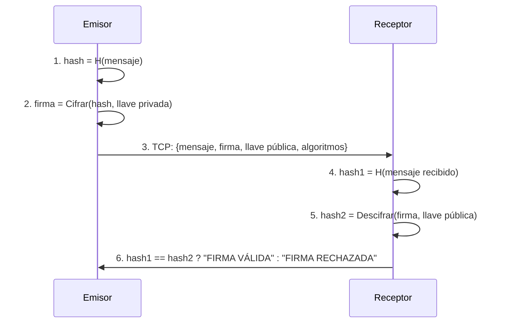
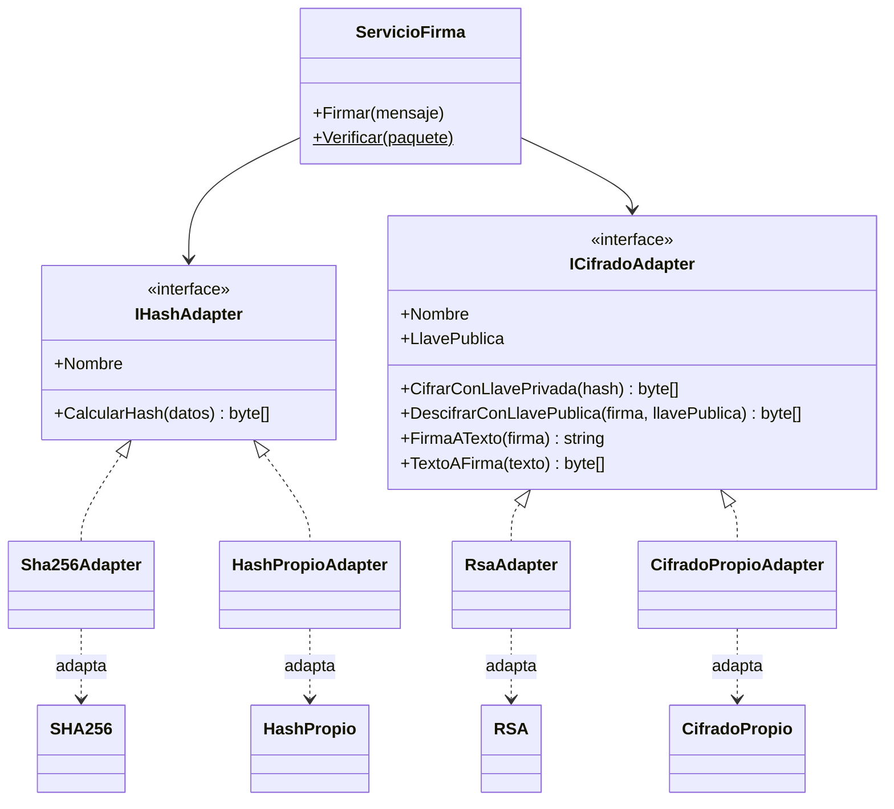

# Laboratorio: Firma Digital (versión consola en C#)

Servicios Multimedia, Facultad de Ingeniería, Universidad de San Buenaventura, Bogotá.
Profesor: Ing. Sergio Alberto Reyes Gómez.

**Integrantes:** Juan Mendez, Natalia Noguera y Karen Quemba.

Aplicación de consola en C# (.NET 10) que implementa el proceso completo de **firma digital**:
escribir un mensaje, hashearlo, cifrar el hash con una llave privada y enviarlo por **TCP** junto con
la llave pública, para que el receptor verifique la **autenticidad** y la **integridad** del mensaje.

- **Punto 1:** se usan las librerías de C# (`SHA-256` y `RSA-2048` de `System.Security.Cryptography`).
- **Punto 2:** las librerías se reemplazan por algoritmos propios (`HashPropio-256` y `CifradoPropio`).
- Toda la parte criptográfica está organizada con el **patrón adaptador**, así que cambiar de librerías a
  algoritmos propios no cambia en nada el flujo de firma ni la red.

> **¿Por qué consola y no Unity?** Unity programa en C# y usa las mismas librerías de .NET
> (`System.Security.Cryptography`, `System.Net.Sockets`). La lógica del laboratorio (hash, llaves, firma,
> TCP) es la misma; solo cambia la interfaz. Si se necesita llevarlo a Unity, las carpetas `Cripto/` y `Red/`
> se copian a `Assets/Scripts` y se conectan a botones y campos de texto en lugar de la consola.

---

## Cómo ejecutarlo

Requisito: [.NET SDK 10](https://dotnet.microsoft.com/download).

```bash
# Menú interactivo
dotnet run --project src/FirmaDigital

# O directamente cada modo:
dotnet run --project src/FirmaDigital -- receptor 5000              # terminal 1: servidor TCP
dotnet run --project src/FirmaDigital -- emisor 127.0.0.1 5000      # terminal 2: cliente TCP
dotnet run --project src/FirmaDigital -- demo                       # demostración automática con ataques
dotnet run --project src/FirmaDigital -- pruebas                    # pruebas de los algoritmos propios
dotnet run --project src/FirmaDigital -- hash "Hola mundo"          # SHA-256 vs HashPropio-256
```

**En dos computadores:** el receptor muestra su IP al iniciar (ej. `192.168.1.9`); en el otro equipo se
ejecuta `emisor 192.168.1.9 5000`. Windows puede pedir permiso en el firewall la primera vez.

---

## Flujo de la firma digital



- Si alguien **cambia el mensaje**, `hash1` ya no coincide con `hash2`: falla la **integridad**.
- Si alguien **firma con otra llave privada**, la firma no se descifra bien con la llave pública del emisor:
  falla la **autenticidad**.

El paquete viaja como JSON precedido de 4 bytes con su longitud (TCP es un flujo de bytes, así el
receptor sabe cuánto leer).

---

## Patrón adaptador



- **Target:** `IHashAdapter`, `ICifradoAdapter`.
- **Adaptee:** las clases `SHA256` y `RSA` de .NET y las clases propias `HashPropio` y `CifradoPropio`,
  cada una con métodos y formatos distintos.
- **Adapter:** `Sha256Adapter`, `RsaAdapter`, `HashPropioAdapter`, `CifradoPropioAdapter`.
- **Cliente:** `ServicioFirma` solo conoce las interfaces. La demo incluso combina `HashPropio-256 + RSA-2048`
  sin tocar el servicio.

---

## Punto 1: librerías de C#

| Librería | Uso | Por qué |
|---|---|---|
| `SHA256` (`System.Security.Cryptography`) | Hash de 256 bits del mensaje | Estándar FIPS 180-4, incluido en .NET, sin dependencias externas. |
| `RSA` (`System.Security.Cryptography`) | Par de llaves de 2048 bits; `SignHash` cifra el hash con la llave privada (PKCS#1 v1.5) | Algoritmo asimétrico estándar (RFC 8017): la llave pública verifica pero no permite firmar. |
| `BigInteger` (`System.Numerics`) | Calcular `firma^e mod n` para **mostrar** el hash recuperado con la llave pública | `RSA.VerifyHash` solo responde verdadero/falso; así se ve el paso "descifrar con la llave pública". La prueba `pruebas` confirma que el resultado coincide con `VerifyHash`. |
| `TcpListener` / `TcpClient` (`System.Net.Sockets`) | Envío y recepción | TCP garantiza que los bytes llegan completos y en orden. |
| `System.Text.Json` | Serializar el paquete | Formato de texto legible y estándar. |

---

## Punto 2: algoritmos propios

### HashPropio-256 (2 pasos)

Estado:esta compuesto por 8 palabras de 32 bits que se inicializan con constantes fijas, calculadas a partir de la parte decimal de √p·π para los numeros primos del 2 al 19.

1. **Absorción**: cada byte del mensaje se incorpora al estado mediante la operacion:
   `h[j] = (h[j] XOR byte) × 0x01000193` y luego `h[j+1] += RotarIzq(h[j], 5)` (con `j = i mod 8`).
   Al terminar tambien se combina la longitud del mensaje.
2. **Mezcla final**:se conserva una copia del estado inicial y se realizan 4 rondas de operaciones que combinan cada palabra con dos posiciones vecinas mediante sumas, XOR, rotaciones, multiplicaciones y desplazamientos. finalmente **se suma la copia guardada**.

¿Por qué es irreversible? porque los mensajes, sin importar su tamaño, se convierten en un resultado de 256 bits, lo que implica perdida de informacion. ademas, las multiplicaciones y operaciones XOR mezclan los bits, mientras que la suma con la copia dificulta recuperar el estado anterior.

### CifradoPropio (2 pasos) + diccionario de `login.js`

**Llaves**
- **Llave privada:** una palabra clave (ej. `gato`). Nunca se envía.
- **Llave pública:** `K = HashPropio(Traducir(palabra))`, 32 bytes. `Traducir` es la misma función `encrypt()`
  de `login.js` con el mismo diccionario: `"gato"` → `mucho`+`vida`+`penguin`+`de` = `"muchovidapenguinde"`.

**Cifrar** (m = bytes del hash, K[i] = byte i de la llave, `ROTL3` = rotar el byte 3 bits a la izquierda,
sumas mod 256):
1. **Sustitución encadenada de ida y vuelta:**
   - ida: `a[i] = ROTL3((m[i] XOR K[i]) + a[i-1])`, con `a[-1] = K[31]`;
   - vuelta (de atrás hacia adelante): `c[i] = ROTL3(a[i] + c[i+1])`, con `c[L] = K[0]`.

   la operacion XOR oculta cada byte utilizando la llave. las sumas con los bytes vecinos permiten encadenar los valores: durante la ida, un cambio afecta los bytes siguientes y, durante la vuelta, y tambien alcanza los anteriores. la rotacion ayuda a distribuir las diferencias entre los bits de cada byte
   
3. **Transposición por saltos:** el byte `i` pasa a la posición `(i × salto + inicio) mod L`. `salto` e
   `inicio` salen de la llave; `salto` no comparte divisores con `L`, así cada byte cae en una posición distinta.

**Descifrar** con K: los pasos al revés (`ROTR3` = rotar a la derecha): devolver cada byte a su posición,
deshacer la vuelta con `a[i] = ROTR3(c[i]) - c[i+1]` y deshacer la ida con
`m[i] = (ROTR3(a[i]) - a[i-1]) XOR K[i]`.

¿Por qué ida, vuelta y rotación? La prueba "Cifrado 6" compara las diferentes variantes utilizando los mismos datos. con unicamente la ida, correspondiente al diseño inicial, modificar un bit cambia en promedio el 11,17% de la firma. al utilizar ida y vuelta sin rotacion, el resultado aumenta al 26,34%. finalmente, al incluir las tres operaciones se alcanza un 49,53%, cercano al 50% ideal.

**Envío con las palabras de `login.js`:** la firma y la llave pública se escriben en hexadecimal y cada dígito
se cambia por su palabra del diccionario (`0`→`uwu`, `1`→`amigues`, `2`→`pongan`, `3`→`bachata`,
`4`→`memotenpiedad`, `5`→`tilin`, `6`→`puffle`, `7`→`pinguino`, `8`→`fife`, `9`→`elbicho`, `a`→`vida`,
`b`→`mucho`, `c`→`tmb`, `d`→`encanta`, `e`→`xd2`, `f`→`XD`). Entre estos 16 dígitos ninguna palabra se
repite, así que se puede volver a los bytes. El `0` no estaba en `login.js` y se le asignó `uwu`.

Ejemplo (`dotnet run -- pruebas`), cifrar `"Hola"` con `gato` (`K[31] = 19`, `K[0] = 112`):

| i | letra | m[i] | K[i] | m XOR K | + a[i-1] | suma | ROTL3 = a[i] |
|---|---|---|---|---|---|---|---|
| 0 | H | 72 | 112 | 56 | 19 | 75 | 90 |
| 1 | o | 111 | 211 | 188 | 90 | 22 | 176 |
| 2 | l | 108 | 233 | 133 | 176 | 53 | 169 |
| 3 | a | 97 | 170 | 203 | 169 | 116 | 163 |

Vuelta, de `i = 3` a `i = 0`: `c[3] = ROTL3(163 + 112) = 152`, `c[2] = ROTL3(169 + 152) = 10`,
`c[1] = ROTL3(176 + 10) = 213`, `c[0] = ROTL3(90 + 213) = 121`.

Paso 2 con salto 3 e inicio 3: `[121, 213, 10, 152]` → `[152, 10, 213, 121]`. Al descifrar se obtiene `"Hola"`.

---

## Resultados de las pruebas (`dotnet run -- pruebas`)

| Prueba | Resultado |
|---|---|
| Determinismo del hash | Mismo hash en todas las ejecuciones |
| Efecto avalancha (10 000 mensajes, 1 bit cambiado) | HashPropio-256: **49,99 %** de bits cambiados; SHA-256: 50,04 % |
| Distribución de bits (10 000 hashes) | 49,98 % de unos; todas las posiciones entre 48,6 % y 51,6 % |
| Colisiones en 200 000 mensajes parecidos | 0 |
| Reversibilidad del cifrado (10 000 mensajes y claves aleatorias) | 10 000 de 10 000 |
| Descifrar con la llave de otra palabra | No recupera el hash |
| Llaves de "gato" vs "gatp" | 132 de 256 bits distintos (firmas: 137 de 256) |
| Difusión del cifrado (10 000 bloques, 1 bit cambiado) | **49,53 %** de bits cambiados |
| Hash recuperado con BigInteger vs `RSA.VerifyHash` | Coinciden |

Demostración (`dotnet run -- demo`): para cada par de algoritmos el mensaje legítimo es **aceptado**, y el
mensaje alterado y el impostor son **rechazados**.

---

## Limitaciones conocidas (para la discusión del informe)

- **CifradoPropio es simétrico en el fondo:** quien tiene la llave pública K puede descifrar, pero también
  podría cifrar. Por eso no da la garantía de RSA, donde la llave pública no permite firmar. Sí protege la
  palabra clave, porque K es un hash de ella. Es el mismo modelo del ejemplo del enunciado (multiplicar y dividir
  con "gato").
- **El diccionario de `login.js` repite palabras** (`y`/`j` = `es`, `p`/`k` = `la`, `i`/`l` = `mejor`,
  `g`/`b` = `mucho`). Por eso no sirve como cifrado reversible por sí solo, y `"ya"` y `"ja"` dan la misma llave.
- **La llave pública viaja con el mensaje:** un atacante podría reemplazar mensaje, firma **y** llave. Para
  evitarlo, emisor y receptor comparan la **huella** de la llave pública (se muestra en ambos lados) por otro
  medio. En la práctica eso lo resuelven los certificados digitales.

---

## Estructura

```
.gitignore                      archivos que Git no debe versionar (ver abajo)
FirmaDigital.slnx               solución de .NET
login.js                        formulario previo del grupo con el diccionario de sustitución
informe/
├── informe.tex                 informe IEEE en LaTeX (para Overleaf)
├── informe.pdf                 versión compilada
├── informe.docx                versión Word editable
└── evidencias/                 salidas completas de demo, pruebas y ejecución en dos procesos
src/FirmaDigital/
├── Program.cs                  menú y comandos
├── Ui.cs                       salida con colores
├── Cripto/
│   ├── IHashAdapter.cs         interfaces objetivo del patrón adaptador
│   ├── ICifradoAdapter.cs
│   ├── ServicioFirma.cs        firmar y verificar (cliente del adaptador)
│   ├── FabricaCripto.cs        crea el adaptador según el nombre que llega en el paquete
│   ├── Libreria/               Sha256Adapter, RsaAdapter
│   └── Propio/                 HashPropio, CifradoPropio, Diccionario (login.js) y sus adaptadores
├── Red/                        PaqueteFirmado, Protocolo, Emisor, Receptor (TCP)
└── Modos/                      ModoEmisor, Demostracion, Pruebas
```

### `.gitignore`

El archivo `.gitignore` le indica a Git qué archivos no debe subir al repositorio. Se generó con la plantilla
oficial de .NET (`dotnet new gitignore`) y excluye, entre otros:

- `bin/` y `obj/`: resultados de la compilación, que cada equipo regenera con `dotnet build`;
- `.vs/` y archivos `*.user`: configuración local de Visual Studio;
- material local que no se publica (el enunciado del laboratorio y copias comprimidas del informe).
